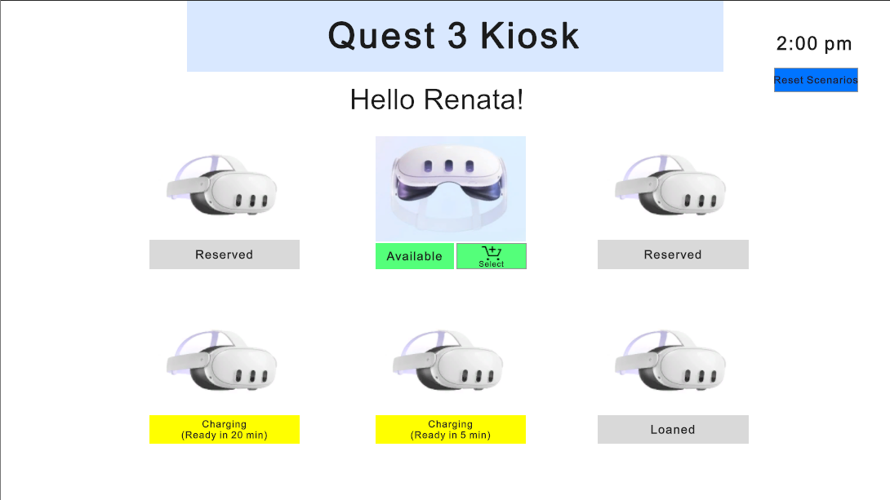
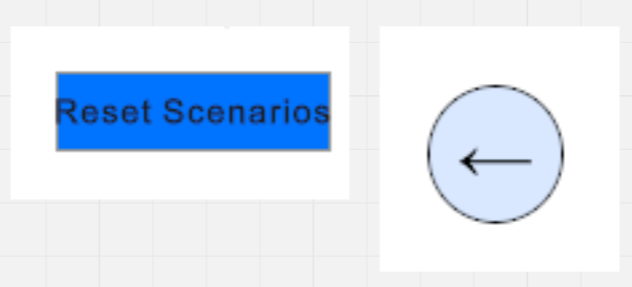
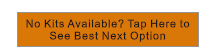

# Design Justification (`docs/design.md`)

This document details key interaction decisions, applied Human-Computer Interaction (HCI) principles, and architectural changes made when transitioning the Quest Checkout Kiosk from the initial Figma prototype into the final Unity application.

---

## 1. Interaction Decisions

### Decision 1: Visual Status Indicators & Color-Coded Availability
* **User Problem:** Users needed an immediate, cognitive-effortless way to determine which Quest 3 kits were available for immediate loan without having to click into individual kit details.
* **HCI Principle:** **Visibility of System Status** & **Recognition over Recall**.
* **Design Solution:** The main menu grid uses clear, high-contrast visual badges for all 6 lockers. Available kits display a prominent green banner with an active "Select" button, while unavailable kits display muted gray/amber tags ("Reserved", "Loaned", "Charging"). This allows users to recognize system state instantly without recalling previous inventory levels.
* **Visual Evidence:** 

---

### Decision 2: Linear Step-by-Step Flow with Universal Reversion Controls
* **User Problem:** Users making decisions on loan duration or reviewing contents risk feeling trapped or losing context if they change their minds midway through checkout.
* **HCI Principle:** **User Control and Freedom** & **Error Prevention**.
* **Design Solution:** A strictly linear wizard flow (Main Menu → Borrow Period → Summary → End Screen) was implemented. Every intermediate screen includes an explicit "Back" button allowing non-destructive edits to choices. Furthermore, a top-level "Reset Scenarios" button is present on all main screens to ensure users and evaluators are never stuck in a navigation dead end.
* **Visual Evidence:** 

---

### Decision 3: High-Affordance Call-to-Action for Zero-Availability (Scenario B)
* **User Problem:** In Scenario B (all kits reserved), users perceived the static "Reserved" grid as an inactive dead end and failed to realize that alternative waitlist/reservation options existed.
* **HCI Principle:** **Affordance and Signifiers**.
* **Design Solution:** Added a vibrant, bold call-to-action button (`BestOptionButton`) positioned below the grid reading. This explicit signifier informs users that the screen is interactive and immediately directs them to the reservation overlay.
* **Visual Evidence:** 

---

## 2. Figma Prototype vs. Unity Implementation Comparison

| Feature / Aspect | Original Figma Design | Final Unity Implementation | Justification for Change |
| :--- | :--- | :--- | :--- |
| **Overlay / Modal System** | Modal popups designed as separate, standalone UI frame screens. | Implemented using nested UI Toolkit visual elements (`UsefulStepOverlay`) toggled via `DisplayStyle.Flex` and `DisplayStyle.None`. | **Technical Efficiency:** Toggling element visibility in UI Toolkit prevents unnecessary screen re-cloning, reduces visual flicker, and simplifies event management in `KioskManager.cs`. |
| **Kit Card Hitbox** | Click targets restricted to explicit "Select" button hotspots. | Expanded clickable area across the entire kit label (`AvailableClickable`) using `ClickEvent` registration. | **Usability Testing Evidence:** User 2 misclicked by attempting to tap the general kit card. Expanding the hitbox improved touch/click affordance and eliminated misclick errors. |
| **Scenario State Persistence** | Static wireframe screens simulating state transitions manually. | Dynamic inventory management utilizing `PlayerPrefs` and JSON serialization (`InventoryData`). | **Implementation Requirement:** Preserves checkout status, locker assignments, and completed Scenario B states across application restarts. |
| **Reset Mechanisms** | Minimal home navigation without system-wide state clearing. | Dedicated `ResetButton` wired across `LoadMainMenu()`, `LoadUnavailableMainMenu()`, and `LoadLastMainMenu()`. | **Usability & Rubric Requirement:** Guarantees evaluators and users can reset persistent data back to Scenario A from any point in the application lifecycle. |

---

## 3. Design Evolution Summary

The transition from Figma to Unity focused on turning static visual concepts into an intuitive, error-tolerant interactive system:
1. **Interactive Refinements:** Physical interaction targets were enlarged to match user expectations gathered during testing.
2. **State Transparency:** Feedback and modal overlays were integrated directly into the layout hierarchy to maintain user orientation throughout both Scenario A (Standard Checkout) and Scenario B (Waitlist / Reservation).