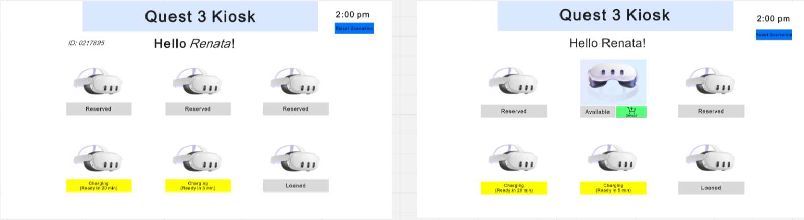
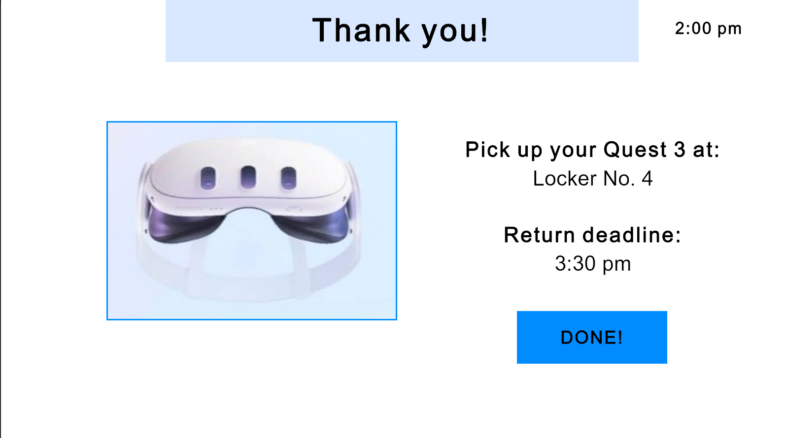
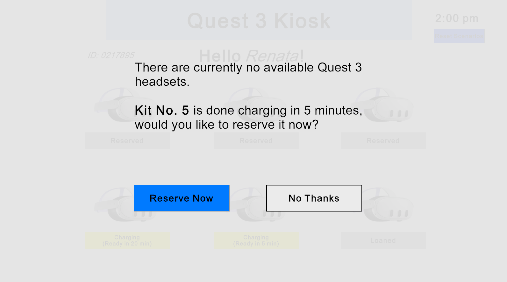
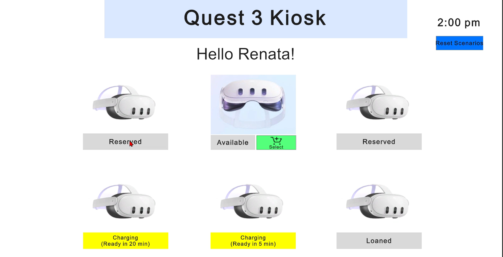
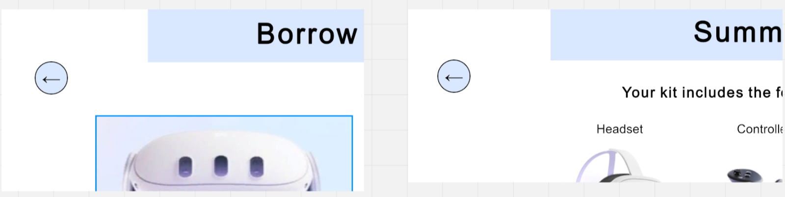
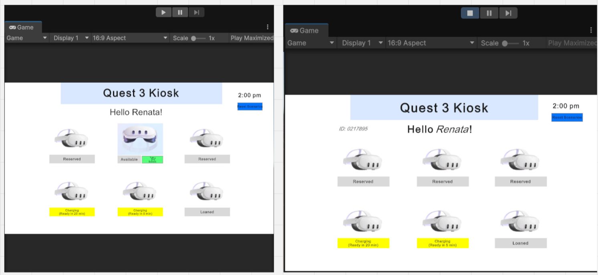

Commit used for tests: 18b2794

Test Case 1: Scenario Reset

    Setup: Kiosk is running with at least one kit loaned out.

    Steps:

    1. Navigate to the Main Menu.

    2. Click the "Reset Scenarios" button in the top right corner.

    Expected Result: PlayerPrefs data is wiped, the inventory resets to the default state, and the app reloads the Main Menu with Scenario A active.

    Actual Result: The data wiped successfully and the Main Menu reloaded with available kits.

    Pass/Fail: Pass.

    Evidence: 

Test Case 2: Checkout (Scenario A)

    Setup: Kiosk is loaded from a fresh reset with Kit 2 Available.

    Steps:

    1. Click "Select" on Kit 2.

    2. Select the "90 Minutes" borrow period and click Continue.

    3. Review the summary and click "Complete".

    Expected Result: The End Screen displays the 90-minute deadline and Locker No. 2. Clicking Done marks the kit as Loaned and updates the inventory.

    Actual Result: The End Screen showed the correct locker and deadline, and the kit status updated to Loaned.

    Pass/Fail: Pass.

    Evidence: 

Test Case 3: No Availability (Scenario B)

    Setup: Kiosk inventory has zero available kits.

    Steps:

    1. Complete the checkout for the final available kit, or load the app with a pre-saved empty inventory.

    2. Observe the screen that loads.

    Expected Result: The system dynamically routes to the Unavailable Main Menu, explaining that no kits are available and providing a working next step.

    Actual Result: The Unavailable Main Menu loaded correctly and displayed the alternative options.

    Pass/Fail: Pass.

    Evidence: 

Test Case 4: Invalid Kit

    Setup: Kiosk is loaded on the Main Menu with at least one kit marked as "Reserved", "Charging", or "Loaned".

    Steps:

    1. Attempt to click on a kit that is not "Available".

    Expected Result: The system blocks the selection and does not advance to the Borrow Period screen, preventing invalid checkouts.

    Actual Result: The selection was blocked and the user remained on the Main Menu.

    Pass/Fail: Pass.

    Evidence: 

Test Case 5: Editing Choices

    Setup: User has selected an available kit and is currently on the Summary screen.

    Steps:

    1. Click the "Back" button on the Summary screen to return to the Borrow Period screen.

    2. Click the "Back" button again to return to the Main Menu.

    3. Select an available kit again to proceed forward.

    Expected Result: The system navigates backwards successfully, allowing the user to review and edit choices without crashing or losing valid information.

    Actual Result: The back buttons successfully reverted the screens, and the flow could be restarted.

    Pass/Fail: Pass.

    Evidence: 

Test Case 6: Saved Data After Restart (Persistence)

    Setup: A kit has been successfully checked out and marked as "Loaned".

    Steps:

    1. Stop Unity Play Mode (or close the built application).

    2. Press Play to restart the application.

    3. Observe the status of the previously checked-out kit.

    Expected Result: The previously checked-out kit remains marked as "Loaned" because the inventory data was preserved using PlayerPrefs.

    Actual Result: The system loaded the saved state correctly upon restart.

    Pass/Fail: Pass.

    Evidence: 